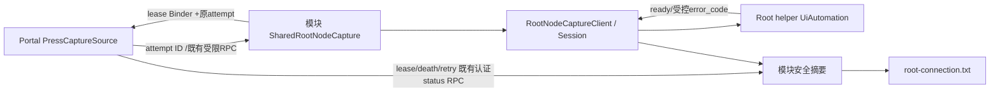

# OCR 与按压取词连接诊断

当前版本、提交与实际验证只见[CURRENT_STATUS](CURRENT_STATUS.md)。两种反馈必须独立判读；没有日志或没有后续阶段，不直接判失败。

## 图片识字

```mermaid
flowchart LR
  UI[图片/屏幕识字入口] --> Client[AicrOcrClient App UID]
  Client --> Bind[AiCrCoreService 绑定]
  Bind --> Core[Core接口核对]
  Core --> Engine[请求V2视觉引擎与Status]
  Engine --> Version[Vision接口与V2版本核对]
  Version --> Image[传入Bitmap]
  Image --> Detect[检测文字]
  Detect --> Result[识别响应与V2结果读取]
  Result --> Release[释放引擎/解绑/原回调]
```

- `AicrOcrClient`固定连接`com.xiaomi.aicr/com.xiaomi.aicr.access.AiCrCoreService`。Core取得引擎和Status后，Vision transaction6必须返回V2，再使用1传图、3检测、4识别。`AicrV2ResultReader`读取既有Parcel格式，不提供OCR模型。
- MMGG的Status7文案映射为系统OCR能力不支持；这只证明本地映射。用户看到相似提示不证明设备确实返回7，更不能证明是旧模型、Root或第三方自动点击造成。
- 每请求新增不透明`aicr-UUID`，`OperationTrace`分别记录bind/connection/core_interface/engine/vision_interface/interface_version/image/execute_detect/result_read/release及受控结果。无图片、正文、地址令牌；既有图片资源指纹是单向摘要，继续保留。
- `plugin_status_7`表示引擎请求返回该数值；`version_unsupported`在图片提交之前；`image_rejected`是传图失败；`result_read_failed`位于transaction4/Parcel结果阶段。若只有泛型Binder失败，具体供应商内部原因仍未知。
- `ImageOcrOverlay`和`ScreenOcrSession`保留原交互与资源owner，只避免任意异常详情进入日志。`Request`借用Bitmap到回调，release/unbind后回调；取消和旧任务回收不变。
- 固定组件版本由`CompatibilityReport`查询AICR与传送门包；安装版本不等于能力可用。历史AICR4.12.26/V2、Portal5.1.5不当成本轮设备信息；已有screenrecognition enable=1不是OCR能力接口。当前客户端及依赖未接入旧OCR模型/替代引擎，本轮不加回退。

## 按压取词

|阶段/资源|负责人|确认条件与上限|
|---|---|---|
|连接尝试|Portal生成ID，lease请求送模块；手动调用也可生成|同ID不等于同进程，proc另外标记|
|su/app_process启动|模块RootNodeCaptureClient|helper_start只是请求启动；失败与连接失败分开|
|UiAutomation|RootNodeCaptureMain/helper进程|ready才是连接确认；已有会话不暴露占用包名|
|Root Session|模块SharedRootNodeCapture|模块拥有，最后lease关闭按原策略释放|
|租赁/死亡监听|Portal Connection/PressCaptureSource|lease_ready、binder_death、release独立记录；lease释放不等于Root helper已退出|
|重试|PressCaptureSource原调度|原间隔不变；即时重连记录0ms；新尝试新ID，复用会话返回其原ID|
|安全摘要|模块RootConnectionDiagnostics|最近80条、当前模块进程寿命；进程重启后旧内存记录不可得|

`Session`持有connectionAttemptId；`session_release`与Portal的lease `release`区分。摘要不控制业务权限、连接成功或重试。已有`report_injected`调用方/构建/lifetime Binder检查保持；新增字段仅传受控单事件，错误元数据不能阻断原状态保存。

## ZIP与日志开关

每包包含`root-connection.txt`和`operation-trace.txt`，不依赖用户开启文件日志。前者收录模块进程和传送门Root检查的有界安全摘要，后者收录当前MMGG应用进程最近160条受控操作阶段；系统原始日志在关闭、写入系统日志或不可读时可以缺失，并由manifest说明。用户只需复现后导出一次诊断ZIP，无需调整日志设置。摘要不是完整日志，也不保留进程重启前的历史；诊断不可用不影响识字或取词功能。

只记录时间、attempt、MMGG进程实例、受控类别、重试间隔；不记录任意异常文本、触摸正文、图片、敏感URI、授权令牌或全量应用列表。占用者始终未知；GKD/Scene只是用户提出的候选，不能从already_registered归因。

## 用户最小复现

分别复现识字和连接一次，记录版本/时间，立即导出诊断包。先看固定组件版本，再看aicr op失败阶段或root attempt的最后确认阶段。若用户愿意做占用对照，一次只暂停一个工具的Root自动点击并重复对照；无设备证据仍写未知。不建议扫描运行应用，也不强行结束所有自动化服务。

测试替身覆盖的是接口边界与生命周期，不能证明真实ROM/供应商能力或真实竞争者已修复。
