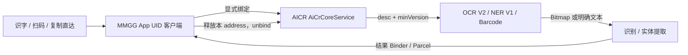

# 小米 / 澎湃系统文本、OCR、NER 与条码接口复用手册

本文是 MMGG 中可复用的系统文本识别相关入口索引和调用指南。以当前源码为准；接口证据和目标 ROM 验证分开陈述。本文不是 Xiaomi SDK，也不承诺跨所有 HyperOS / AICR 版本兼容。

## 快速选择

| 需求 | 采用接口 | 传入内容 | 返回 | 适用边界 |
|---|---|---|---|---|
| 从已获得的 Bitmap 识别文字 | `AicrOcrClient` → AICR `IVisionService` V2 | Bitmap | 全文，或全文加行文字与原始坐标 | 目标设备需实际提供 OCR V2；没有隐式引擎回退 |
| 从已有字符串提取电话、网址、位置等实体 | `AicrNerClient` → AICR `INerService` V1 | 显式传入的字符串 | 实体文字、类型、原文偏移 | 客户端不会读取剪贴板，但文本会发给 AICR |
| 从已获得的 Bitmap 识别二维码/条码 | `AicrBarcodeClient` → AICR `IBarcodeService` | Bitmap | 去重且保持返回顺序的码值 | 不使用 OCR 的 V2 版本查询；Core 插件申请版本为空字符串 |
| 将文本拆成词与字素安全的片段 | Android ICU `BreakIterator` | 字符串 | UTF-16 原文范围 | Android 平台 API；词典随系统版本变化，不是 Xiaomi Binder 服务 |
| 从传送门当前按压内容取得文字/图片 | `PortalHooks` / `PortalContentCaptureSource` | Portal 当前会话 | 带来源标记的文字或 Bitmap | 这是 Taplus 内容捕获 Hook，不负责 OCR/条码识别 |

系统翻译 SDK 是另一条未接入的接口研究，见[小米翻译接口调查](XIAOMI_TRANSLATION.md)；不要把它当作 OCR、NER 或上述客户端的回退引擎。

## 共同 AICR Core 连接

三个 AICR 客户端都以应用自身 UID 直接绑定：

```text
package:   com.xiaomi.aicr
service:   com.xiaomi.aicr.access.AiCrCoreService
action:    com.xiaomi.aicr.access.AICR_ENGINE
extra:     bind_type = 本次请求唯一 address
descriptor: com.xiaomi.aicr.IAiCrCoreService
```

典型次序是：应用 UID bind → 等 `ServiceConnection` → 校验 Core descriptor → Core transaction 1 请求某个插件并读取 Binder / `Bundle.Status` → 执行插件协议 → Core transaction 2 释放本次 address → unbind → 主线程回调。

每次请求必须新建自己的 address，只释放自己申请的连接。不要强停 AICR、释放其他客户端会话，也不要用 Root UID 成功替代模块普通 UID 的可用性验证。Binder 调用是同步事务时，设置取消标记并不能中断正在执行的远端调用。



### 版本和能力判断

- `CompatibilityReport` 可报告 `com.xiaomi.aicr` 包的已安装版本名/版本号，并同时报告 Portal 包版本。这是环境摘要，不是 OCR 能力探测。
- MMGG 提供默认关闭的全局兼容开关，复用 AICR 专用 Provider 设置 RPC。开启时只将 AICR Core `onTransact` 调用中普通应用 UID 对 system UID 的签名比较视为通过；未开启时沿用仅 MMGG 的既有兼容。此 Hook 不会跳过插件 `Status`、V2/V1、能力、模型或其他权限检查；因此不能保证所有应用在所有 ROM 都能调用成功。Provider 设置无法读取时保留系统原签名判断。
- OCR 的实际运行时核验发生在插件请求：Core 返回 `Status` 和 Vision Binder 后，客户端核对 interface descriptor，再调用 Vision transaction 6 `getOCRVersion()` 并要求返回 `V2`。
- NER 在 Core 插件申请时传 `V1`；当前客户端核对 Binder descriptor 和 Core `Status`，没有独立版本查询事务。
- Barcode 在 Core 插件申请时传空字符串；客户端核对 descriptor 和 `Status`，没有 `getOCRVersion()` 步骤，也不能照搬 OCR 的 `V2` 参数。
- 静态 AICR 接口资料记录 Core 还有 `isSupport(desc)` 事务 3；当前这三个生产客户端不把它当作 OCR/NER/Barcode 的前置判据。诊断包中有 AICR 版本，不能据此声称某能力可用；真正能力仍以对应插件调用结果为准。
- 不同插件的状态文案与状态映射可能不同。不要把 OCR Status 7 直接复用为条码或 NER 的产品结论，也不要从用户看到的一句话反推 AICR 实际返回了哪一个 Status。

## Hook AICR：边界选择与抗混淆维护

MMGG 的 Hook 用来适配 AICR Core 的一处签名检查。它不能阻止小米混淆 AICR；做法是尽量 Hook 稳定的 Android 接口，并用运行时条件识别目标调用。

### 安装与命中条件

[`MainHook.java`](../app/src/main/java/com/leaf/hyperdragshare/codex/MainHook.java) 只在 `com.xiaomi.aicr` 进程调用 [`AicrCoreAccessHooks.install()`](../app/src/main/java/com/leaf/hyperdragshare/codex/AicrCoreAccessHooks.java)。Hook 点是 Android framework 的 `ApplicationPackageManager.checkSignatures(int,int)`，不直接 Hook AICR 私有 helper。

`Application.attach(Context)` 提供 AICR 进程自己的 `ContentResolver`，用来通过已有 AICR 专用 Provider RPC 读取用户开关。只有以下条件同时成立才返回 `SIGNATURE_MATCH`：

1. Binder 调用 UID 是普通应用 UID，并能解析到调用包名。
2. 比较参数是“调用 UID 与 `SYSTEM_UID`”。
3. 调用栈命中 AICR Core `AiCrCoreService$…onTransact`。
4. 调用包是 MMGG，或现有 `get_aicr_settings` RPC 返回全局开关已开启。

其他调用保持 Android 原结果。设置默认关闭；读取失败也按关闭处理。此开关只放行这一项 Core 比较，不会自动通过 AICR 插件版本、能力或其他权限检查。

代码结构大致如下，具体 UID、包名和调用栈判断在 `isAicrCoreSignatureComparison` 中：

```java
XposedHelpers.findAndHookMethod(
    "android.app.ApplicationPackageManager", null,
    "checkSignatures", int.class, int.class,
    new XC_MethodHook() {
        @Override protected void beforeHookedMethod(MethodHookParam param) {
            if (isAicrCoreSignatureComparison(/* Binder UID, args, packages, stack */)
                    && (callerIsMmgg() || readGlobalSetting())) {
                param.setResult(PackageManager.SIGNATURE_MATCH);
            }
        }
    });
```

### 混淆后如何找到正确 Hook 点

- 实机第一次失败是类名对错了：JADX 把类显示为 `defpackage.u8`，但 DEX 描述符是 `Lu8;`，表示根包类 `u8`。照抄 JADX 展示名去查找，Hook 就不会命中。这不是设备运行时改名，而是反编译器展示名与真实类描述符不同。
- 排查私有类时，先从目标 APK 的 DEX descriptor 确认类和方法，再用 AICR 的 `ClassLoader` 检查运行时类名、参数和返回类型。不要只按 JADX 左侧类名直接写 Hook。
- 更稳妥的方式是 Hook 最终经过的 Android API，再用 Binder UID、方法参数、调用栈和包名把目标请求收窄。当前实现不依赖那个 helper，但仍用 `AiCrCoreService$` 前缀识别 Core 调用；若这个服务类也变化，Hook 会不命中并保留系统行为，需要按新版本证据更新谓词。
- “动态找类”不能只靠模糊类名。候选必须由接口描述符、方法签名和实际调用验证；出现多个候选时不应任意选一个。动态发现只能减少硬编码，不能保证 AICR 以后永不变化。

### AICR 更新后的最短检查流程

1. 记录 ROM、AICR 版本和 APK 哈希，确认对比的是实际安装样本。
2. 确认 `MainHook` 在 AICR 进程加载，framework 方法签名仍存在，Core 调用栈谓词仍能识别目标。
3. 分别测试开关关闭与开启；再确认无关签名比较仍走系统原逻辑。
4. 检查 AICR Core 返回状态、插件版本/能力、图片或文本输入及结果回调。Hook 命中只证明跨过了该签名门，不代表识别已完成。

Hook 代码在[`AicrCoreAccessHooks.java`](../app/src/main/java/com/leaf/hyperdragshare/codex/AicrCoreAccessHooks.java)，模块入口在[`MainHook.java`](../app/src/main/java/com/leaf/hyperdragshare/codex/MainHook.java)。

## 让接口实际运行

1. 确认设备提供 `com.xiaomi.aicr` 及所需插件/引擎；启用 MMGG 的 LSPosed 模块，并将作用域包含 `com.xiaomi.aicr`。修改 Hook 代码或作用域后，重载 AICR 进程；只切换全局开关从下一次 Core 请求生效。
2. 若调用方不是 MMGG，在 MMGG“通用设置 → 运行与权限”开启“全局兼容澎湃 AI 引擎签名校验”。开关默认关闭。
3. 调用本项目的客户端封装：OCR 用 `AicrOcrClient.recognize(context, bitmap, callback)`；NER 用 `AicrNerClient.extract(context, text, callback)`；条码用 `AicrBarcodeClient.scan(context, bitmap, callback)`。这些封装直接绑定 AICR Core，并在主线程回调。
4. 传入自己已取得的 Bitmap 或文本；Bitmap 保持有效直到回调完成。检查日志和错误阶段：绑定、Core 插件状态、接口版本、输入、识别/回调。若服务返回“不支持”或版本不匹配，签名 Hook 本身无法补出该能力。

这些客户端是 MMGG 源码中的实现，不是对外发布的 SDK。其他项目复用时应按下面的 Binder 参数/事务表移植客户端协议，再在目标 ROM 上验证。

## 图片文字识别：AICR Vision V2

实现：[`AicrOcrClient.java`](../app/src/main/java/com/leaf/hyperdragshare/codex/AicrOcrClient.java)、[`AicrV2ResultReader.java`](../app/src/main/java/com/leaf/hyperdragshare/codex/AicrV2ResultReader.java)、[`AicrOcrResult.java`](../app/src/main/java/com/leaf/hyperdragshare/codex/AicrOcrResult.java)。产品调用边界见[图片与屏幕识字](IMAGE_OCR.md)与[OCR 连接诊断](OCR_CONNECTION_DIAGNOSTICS.md)。

### 调用协议

Core transaction 1 `getPluginBinder` 参数顺序：

```text
ICoreServiceCallback Binder
address String
com.xiaomi.aicr.plugin.IVisionService String
V2 String
```

返回插件 Binder 和包含 `Status` 的 Bundle。拿到插件后，先核对 descriptor 为 `com.xiaomi.aicr.plugin.IVisionService`，再按以下顺序调用：

| Vision transaction | 含义 | 参数 / 返回 |
|---|---|---|
| 6 | 查询 OCR 接口版本 | 返回 String，当前实现必须是 `V2` |
| 1 | `setImage` | 写 typed `Bitmap`，返回图片 session 整数 |
| 3 | `doOCRDetect` | 写 session；返回检测行数，负数表示 session 无效，0 表示没有检测到文字 |
| 4 | `doOCRRecognize` | 写 session；返回 AICR OCRResult typed Parcel |

执行顺序是 `version → setImage → detect → recognize`。当前实现使用 typed `Bitmap` 入口，结果布局由 `AicrV2ResultReader` 读取。

### 结果和返回格式

`AicrV2ResultReader.readResult` 按 AICR wire 顺序读取 Parcelable、段落、行、字符坐标、`total_text` 和 entities。坐标保持协议原值，不在 reader 中猜测成屏幕坐标。

常见错误状态见 `AicrOcrClient.statusMessage`：0 成功、1 模型准备、2 版本不匹配、3 服务断开、4 服务错误、5 无引擎、6 图片传入失败、7 OCR 能力不支持、8 权限拒绝。排查时保留具体失败阶段，便于区分连接、能力和图片问题。

### Kotlin / Java 调用示例

```java
AicrOcrClient.Request request = AicrOcrClient.recognize(context, bitmap, (text, error) -> {
    // 回调在主线程；完成 Core release/unbind 后只回调一次。
    if (error != null) showFailure(error);
    else showRecognizedText(text);
});
// 窗口关闭时可 request.cancel()；同步 Binder 不会因此立刻中止。
// 调用方持有 Bitmap 至回调完成（包含 cancel 后的最终回调），不要提前 recycle。
```

需要结构行结果时调用 `recognizeWithLines`，使用 `AicrOcrResult.text` 与 `lines`；兼容全文调用仍由 `recognize` 提供。当前 `ImageOcrOverlay` 图片入口先将软件 Bitmap 的最长边限制为 4096px，再调用客户端；屏幕/区域路径由 `ScreenOcrSession` 管理截图与取消。

OCR 客户端一次只接受一个活动请求；连接等待上限为 15 秒。Bitmap 由调用方持有，直到回调完成后再释放。

## 字符实体提取：AICR NER V1

实现：[`AicrNerClient.java`](../app/src/main/java/com/leaf/hyperdragshare/codex/AicrNerClient.java)，当前消费方包括[`CopyDirectSuggestions.kt`](../app/src/main/kotlin/com/leaf/hyperdragshare/codex/CopyDirectSuggestions.kt)。

通过同一个 Core 连接申请 descriptor `com.xiaomi.aicr.plugin.INerService`，minVersion 为 `V1`。Core 返回成功状态和 Binder 后，NER transaction 1 接收一个 String，返回包含实体条数及每个实体的 presence marker、text、type、start、end 的 Parcel。当前支持类型常量包括 LOCATION、ID、TEL、BCN、TRAIN、FLN、CAR、ORDER、ENO、MAIL、URL、TAX_ID。

调用方应显式传入待提取字符串。`AicrNerClient` 不读剪贴板、不自动重试、不切其他引擎；但原文会作为 Binder 参数发送给 AICR。结果 offset 对应服务返回的输入文字偏移，消费前应使用原输入核对范围，不要对已变换文字直接套用。

```java
AicrNerClient.extract(context, text, (entities, error) -> {
    if (error != null) showFailure(error);
    else showEntities(entities); // Entity 包含 text、type、start、end
});
```

## 二维码 / 条码：AICR Barcode 插件

实现：[`AicrBarcodeClient.java`](../app/src/main/java/com/leaf/hyperdragshare/codex/AicrBarcodeClient.java)，图片浮窗入口见[`ImageOcrOverlay.kt`](../app/src/main/kotlin/com/leaf/hyperdragshare/codex/ImageOcrOverlay.kt)。

Core transaction 1 参数为 callback Binder、address、`com.xiaomi.aicr.plugin.IBarcodeService`、空字符串版本。读回 Binder 与 Bundle `Status` 后，核对 descriptor `IBarcodeService`。该接口没有 OCR 的 `getOCRVersion()`。插件事务：

| Barcode transaction | 含义 | 参数 / flags |
|---|---|---|
| 1 | 注册结果监听 | listener Binder、address；同步 |
| 3 | 提交图片 | typed `Bitmap`、address；oneway |
| 2 | 注销监听 | address；oneway |

`IBarcodeResultListener` callback transaction 1 返回 typed `BarcodeBean` 列表。客户端按 wire 顺序消费 valueType、rawValue、cornerPoints、Rect、barcodeFormat，只将非空码值去重并保留服务顺序返回 UI；它不加载 AICR 私有 Java 类。

Barcode 当前状态映射包括：1 模型准备、2 插件版本不匹配、7 不支持扫码、8 权限拒绝。每个完成/取消/失败路径应注销本请求 listener、向 Core 释放 address 并 unbind；复用现有 Request 生命周期，不要从 OCR 客户端复制状态映射或合并成一个跨插件状态表。

示例：

```java
AicrBarcodeClient.Request request = AicrBarcodeClient.scan(context, bitmap, (values, error) -> {
    // 回调在主线程并在清理后到达。空列表代表没有码值；error 代表失败。
    if (error != null) showFailure(error);
    else showCodes(values);
    // 调用方此前持有的 Bitmap 到此回调时才可释放。
});
// 窗口关闭：request.cancel()；仍不要提前释放传入的 Bitmap。
```

当前图片浮窗的扫码入口使用 AICR `IBarcodeService`，回调返回码值列表。

## Android ICU：文本分词

实现：[`TextSegmenter.java`](../app/src/main/java/com/leaf/hyperdragshare/codex/TextSegmenter.java)。使用 `android.icu.text.BreakIterator` 的 `Locale.ROOT` word boundary，并以 character boundary 对齐范围，避免拆开组合重音、代理对、肤色修饰符或 ZWJ emoji。

返回范围是原始 String 的 UTF-16 inclusive end，词范围与 `-1` 分隔的标点/字素范围组合，空白保留在原文而不是变成选词块。它不是 jieba，也不绑定 AICR；系统 ICU/词典版本变化可能改变分词边界。需要稳定、可指定词典的跨 Android 分词时，必须另选并评估独立词典库，不要把本接口描述成 Xiaomi 云服务。

## Portal 内容捕获：识别前的来源适配

`PortalHooks` 在 `com.miui.contentextension` 进程适配传送门现有 `TextContentExtensionService` 回调；[`PortalContentCaptureSource.java`](../app/src/main/java/com/leaf/hyperdragshare/codex/PortalContentCaptureSource.java) 读取该次会话文字或与当前图片模式匹配的 Bitmap，并创建带来源标记的 `CapturedContent`。图片为避免 Portal `cancelTask()` 回收宿主缓存，会建立独立 snapshot。Portal 捕获的结果随后交给 MMGG 已有拖拽、暂存或 OCR 路径。

Portal 捕获是特定 ROM 的宿主适配，不是 OCR Binder。它把本次按压取得的内容交给上层；实际识别由 AICR 客户端完成。

## 复用时记住

- 输入由调用方提供：OCR/条码传 Bitmap，NER 传文本。Bitmap 保持有效直到回调完成。
- 每次调用创建自己的 Core address，并使用客户端的清理流程。
- 日志记录阶段和状态即可，不记录识别文本、条码内容或图片。
- 排查时看 Core `Status`、插件版本/能力和输入阶段，不要只看 AICR 版本号。

## 证据与兼容范围

- 协议细节来自当前客户端、Parcel reader 和测试；旧接口调查见[AICR OCR 可行性记录](archive/2026-11-02/AICR_OCR_FEASIBILITY.md)，当前验证见[当前状态](CURRENT_STATUS.md)和[设备验证](DEVICE_VALIDATION.md)。
- OCR 产品路径已在小米 15 Pro / HyperOS 4.0.0.17 / Android 17 / AICR 4.12.26 验证；条码有该 AICR 样本的 wire 证据和项目验证记录。其他版本需按上面的步骤复核。
